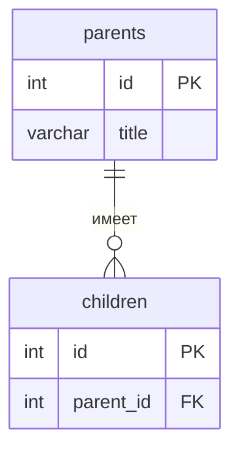

# Название проекта

Тема №31: Приют для животных. Одна фраза: Животные приюта и заявки на то, чтобы забрать их домой.

| | |
| --- | --- |
| Главная сущность | Животное |
| Связанная сущность (1:N) | Заявка |
| Фишка | ... |
| Стек | язык, фреймворк, база данных |

## Как запустить

```bash
# команды по порядку: от git clone до работающего сервиса
# 1. Создайте виртуальное окружение: `python -m venv venv` 
# 2. Активируйте его:
#   * Windows: `venv\Scripts\activate`
#   * Linux/macOS: `source venv/bin/activate` 
#3. Установите зависимости: `pip install -r requirements.txt` 
#4. Запустите сервер: `uvicorn main:app --reload --port 8000` 
# Сервис будет доступен по адресу `http://localhost:8000`.
```

Сервис работает на `http://localhost:8000`. Запросы для демонстрации лежат в `requests.http`.

## Эндпоинты

| Метод | Путь | Описание | Коды ответа | 
|---|---|---|-----| 
| GET |	/logs |	Получение истории запросов (логов) с пагинацией	| 200 |
| GET | /health | Проверка здоровья | 200 | 
| GET | /api/animals | Список с пагинацией и фильтрацией (по статусу и виду) | 200 | 
| POST | /api/animals | Добавление нового животного | 201, 400 | 
| GET | /api/animals/{id} | Получение животного по ID | 200, 404 | 
| PUT | /api/animals/{id} | Полная замена данных животного | 200, 400, 404 | 
| PATCH | /api/animals/{id} | Частичное обновление (например, смена статуса на "пристроено") | 200, 400, 404 | 
| DELETE | /api/animals/{id} | Удаление записи о животном | 204, 404 |

## ER-диаграмма

<!-- С лабы 2. Блок mermaid GitHub рисует сам. -->



## Интерфейс

<!-- С лабы 4: скриншот, например  -->
